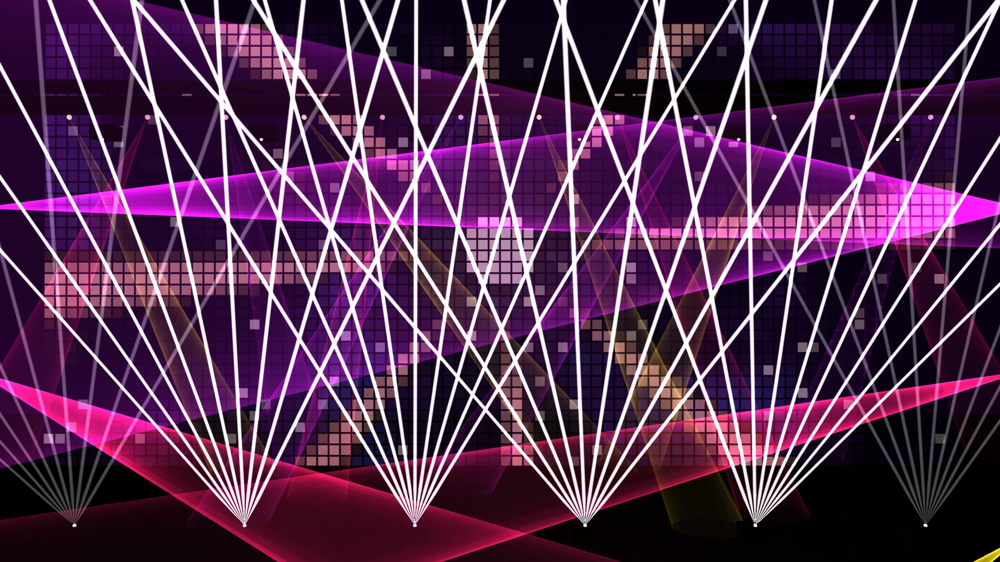
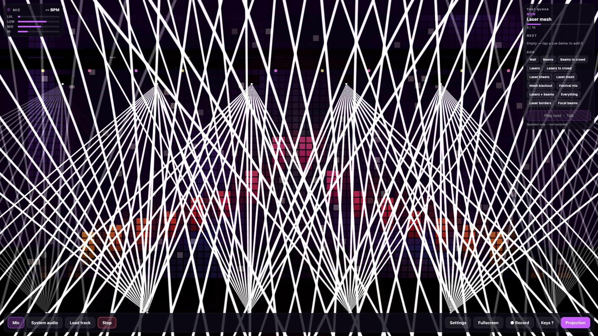
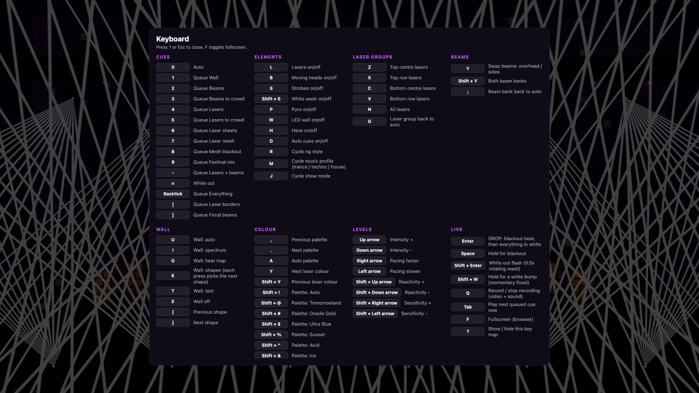
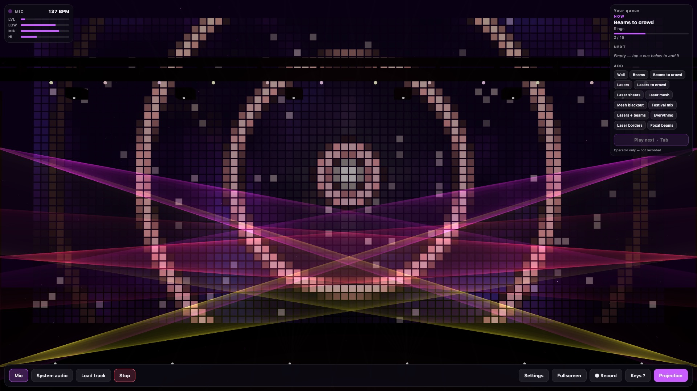

# Stage Visualizer

A Tomorrowland-style lighting rig in the browser. Drop a laptop on the DJ booth, put the keyboard in your left hand, and call lasers, moving heads, LED wall looks and a full laser mesh the same way an operator works a lighting desk.

One Expo / React Native codebase — **web, iOS and Android**.

<p align="center">
  
</p>

## What you are looking at

| Element | What it does |
| --- | --- |
| **Lasers** | Floor and truss fans. One laser, then the bottom row, then sheets, then a slow-folding **mesh**. |
| **Moving heads** | Overhead and side banks, separately. Cue them into the crowd, hold eye contact, then lift like a cloud. |
| **LED wall** | Pixel galaxy, spectrum, heat map, shapes, text. Big drops punch a white burst, then Earth. |
| **Keyboard** | Every cue is a key. `7` holds laser mesh, `` ` `` is everything, `Enter` is the drop, `?` is the cheat sheet. |
| **Audio** | Mic, a track from disk, or (web) system audio via screen share. BPM, groove and onsets drive the director. |

The director listens to the track: no beat → heads lock centre; kick returns → laser rise; rhythm change → back to beams. You can still grab the desk — queue a cue, or hold mesh / sheets until you call the next look.

## Run it

```bash
npm install
npm run web        # Chrome. On a Mac, share the screen with “Share system audio”.
npm run ios        # development build (not Expo Go)
npm run android
```

Native audio (`react-native-audio-api`) and `expo-gl` need a dev build:

```bash
npx expo prebuild
npx expo run:ios      # or run:android
```

## Keyboard as the lighting desk

Press **?** in the browser for the full map. The ones you will actually use in a booth:

| Key | Cue |
| --- | --- |
| `0` | Auto |
| `3` | Beams to crowd |
| `4` | Lasers |
| `6` | Laser sheets |
| `7` | Laser mesh (holds) |
| `9` | Festival mix |
| `` ` `` | Everything |
| `Enter` | Drop (blackout, then white) |
| `Space` | Hold blackout |
| `q` | Record the show (video + sound) |
| `f` | Fullscreen |
| `z` `x` `c` `v` `n` | Laser groups (top / bottom / all) |
| `y` | Swap beam banks |

Mesh, sheets and mesh-blackout **hold** until you call something else — they do not get stolen by the next auto phrase.

<p align="center">
  
</p>

<p align="center">
  
</p>

<p align="center">
  
</p>

## Stack

Expo 57 · React Native / RN Web · Three.js / React Three Fiber · Web Audio (web) · `react-native-audio-api` (native) · GLSL LED wall.

## Deploy

- **Web:** `npm run web:build` writes `dist/`. `vercel.json` and `netlify.toml` are in the repo.
- **Mobile:** `npm run build:android` / `npm run build:ios` (EAS, see `eas.json`).

## License

[MIT](LICENSE) © Alain Egho
